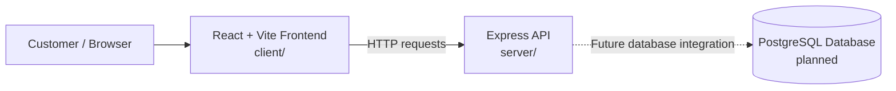

# FilmHall

A web application that allows users to browse movies, view showtimes, select seats, and book cinema tickets.

## Architecture

FilmHall is organized as a React frontend, an Express API, and a planned PostgreSQL data layer. The frontend and API are present in the repository; database integration is not implemented yet.

See [architecture.md](./architecture.md) for the architecture details and current project structure.
