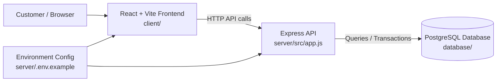

# FilmHall Architecture

## Overview
FilmHall is a full-stack cinema booking application built with a React frontend and an Express API backend. The system is structured for future expansion into movie discovery, showtime browsing, seat selection, and booking flows.

## High-Level Architecture

## Layered Design

### 1. Presentation Layer
- Location: `client/`
- Stack: React + Vite
- Responsibility:
  - Display movie listings, showtimes, and booking UI
  - Serve the SPA from the browser
  - Communicate with the API layer through HTTP requests

Current implementation:
- `client/src/App.jsx` contains the landing page and welcome content.
- `client/src/main.jsx` boots the React app.
- `client/src/styles/global.css` holds global styling.

### 2. Application Layer
- Location: `server/src/`
- Stack: Node.js + Express
- Responsibility:
  - Expose REST endpoints
  - Validate requests
  - Apply middleware such as CORS and JSON parsing
  - Coordinate business logic and database access

Current implementation:
- `server/src/app.js` configures the Express app and the health endpoint
- `server/src/server.js` starts the backend on the configured port

### 3. Data Layer
- Location: `database/`
- Structure:
  - `database/migrations/`
  - `database/seeds/`
- Responsibility:
  - Store application data such as movies, screenings, seats, bookings, and users
  - Support schema evolution through migrations
  - Seed reference data for local development

The project currently includes the database folder structure and is ready for PostgreSQL integration.

## Runtime Flow

1. A user opens the frontend in the browser.
2. The React client renders the FilmHall experience.
3. The frontend calls backend endpoints such as `/api/health`.
4. The Express server processes the request.
5. The backend interacts with PostgreSQL when business features are implemented.
6. Results are returned to the frontend and rendered to the user.

## Security and Config

- CORS is configured in `server/src/app.js` using the `CLIENT_ORIGIN` environment value.
- The server reads environment variables through `dotenv`.
- `server/.env.example` documents the expected config values:
  - `PORT=3000`
  - `CLIENT_ORIGIN=http://localhost:5173`

## Suggested Feature Modules

The project structure already anticipates modular domain boundaries:

- `client/src/features/movies/` — movie browsing and details
- `client/src/features/showtimes/` — showtime selection
- `client/src/features/booking/` — seat and booking flows
- `server/src/controllers/` — request handlers
- `server/src/services/` — business logic and integrations
- `server/src/models/` — database models
- `server/src/middleware/` — validation, auth, and request filtering

## Deployment Concept

The current architecture is designed as a standard web app split into:
- a frontend client (React/Vite)
- an API server (Express/Node.js)
- a PostgreSQL database

This makes the app easy to deploy in a containerized or cloud environment while keeping the frontend and backend independently scalable.

## Current State

This project is in an early but structured foundational state:
- frontend shell exists
- backend API skeleton exists
- health endpoint exists
- database folders are prepared
- architecture is defined and ready for feature implementation

## Future Architecture Evolution

As the product grows, the architecture can expand with:
- authentication and authorization
- payment service integration
- ticket reservation workflow management
- admin dashboard for cinema operations
- caching and observability
- CI/CD pipelines and automated deployment
